# P1F-Census: Perfect 1-Factorizations of K18–K26 with Non-Trivial Automorphisms

<!-- The web page shows the repository link, GitHub shows the web-page link. On the web page Liquid
     turns the first block into an empty comment and the line into text; GitHub keeps it all a comment. {{ "-" | append: "->" }}
**Repository (source code, run scripts, catalogues):** <https://github.com/LeAndr-Graph/P1F-Census>
{{ "<!" | append: "--" }} -->
<!--  -->
**Web page:** <https://leandr-graph.github.io/P1F-Census/>
<!--  -->

**K18:** there are exactly **10,710** pairwise non-isomorphic perfect 1-factorizations (P1Fs) of
K18 with a non-trivial automorphism group (|Aut| > 1).

| \|Aut\| | 2 | 3 | 4 | 8 | 16 | 17 | 272 |
|---|---:|---:|---:|---:|---:|---:|---:|
| classes | 10,179 | 351 | 144 | 22 | 12 | 1 | 1 |

Catalogue: [`AllResults/K18_P1F_aut_gt1.txt`](AllResults/K18_P1F_aut_gt1.txt) ·
dataset DOI [10.5281/zenodo.22238984](https://doi.org/10.5281/zenodo.22238984) ·
runs: [`runs/K18/`](runs/K18/) · paper: submitted to *Australas. J. Combin.*, preprint [arXiv:2611.01807](https://arxiv.org/abs/2611.01807)

**K20:** there are exactly **149,836** pairwise non-isomorphic perfect 1-factorizations (P1Fs) of
K20 with |Aut| > 2.

| \|Aut\| | 3 | 6 | 9 | 18 | 19 | 57 | 171 | 342 |
|---|---:|---:|---:|---:|---:|---:|---:|---:|
| classes | 149,606 | 168 | 46 | 9 | 3 | 1 | 2 | 1 |

Catalogues: [`AllResults/K20_P1F_aut_gt3.txt`](AllResults/K20_P1F_aut_gt3.txt),
[`AllResults/K20_P1F_aut_eq3.txt.gz`](AllResults/K20_P1F_aut_eq3.txt.gz) ·
dataset DOIs [10.5281/zenodo.22215011](https://doi.org/10.5281/zenodo.22215011) (|Aut| > 3),
[10.5281/zenodo.22880728](https://doi.org/10.5281/zenodo.22880728) (|Aut| = 3) ·
runs: [`runs/K20/`](runs/K20/)

**K22:** there are exactly **687** pairwise non-isomorphic P1Fs of K22 with |Aut| > 6,
|Aut| = {7:536, 10:126, 20:20, 21:3, 110:1, 220:1}.
Catalogue: [`AllResults/K22_P1F_aut_gt6.txt`](AllResults/K22_P1F_aut_gt6.txt) ·
dataset DOI [10.5281/zenodo.23840055](https://doi.org/10.5281/zenodo.23840055) ·
runs and proof of scope: [`runs/K22/`](runs/K22/)

**K24:** there are exactly **561** pairwise non-isomorphic P1Fs of K24 with |Aut| > 3,
|Aut| = {11:531, 22:21, 23:4, 253:4, 506:1}; four of them give atomic Latin squares of order 23.
Catalogue: [`AllResults/K24_P1F_aut_gt3.txt`](AllResults/K24_P1F_aut_gt3.txt) ·
dataset DOI [10.5281/zenodo.23845194](https://doi.org/10.5281/zenodo.23845194) ·
runs and proof of scope: [`runs/K24/`](runs/K24/)

**K26** (per automorphism type, not by |Aut|): **23** classes with an automorphism of type 25 1 and
**36** with one of type 24 1², as counted by Pike and Shalaby (2003).
Catalogue: [`AllResults/K26_P1F_rot25_24.txt`](AllResults/K26_P1F_rot25_24.txt) ·
runs: [`runs/K26/`](runs/K26/)

**Derived:** 104,088 P1Fs of K17,17 from the K18 catalogue,
[10.5281/zenodo.22548329](https://doi.org/10.5281/zenodo.22548329).

**Uniform 1-factorizations:** all uniform 1-factorizations of K18 are perfect: no non-Hamiltonian cycle type exists, [10.5281/zenodo.24074760](https://doi.org/10.5281/zenodo.24074760).

**Verification:** the same engine reproduces the known K14 classification (Dinitz and Garnick, 1996)
and the K16 classes with |Aut| > 1 (Gill and Wanless, 2020):
[`AllResults/K14_P1F_aut_gt1.txt`](AllResults/K14_P1F_aut_gt1.txt) (21),
[`AllResults/K16_P1F_aut_gt1.txt`](AllResults/K16_P1F_aut_gt1.txt) (89),
[`runs/K14/`](runs/K14/), [`runs/K16/`](runs/K16/), [`regression/`](regression/).

## Authors

Andrei V. Ivanov, ORCID [0000-0002-1574-6716](https://orcid.org/0000-0002-1574-6716), died September 2026. 
Leonid M. Tertitski, ORCID [0009-0002-7556-9552](https://orcid.org/0009-0002-7556-9552) (corresponding).

**AI assistance:** the extensions for K22 and above (engine changes, run scripts) and much of the
documentation were developed with AI coding assistants (Google Antigravity, Anthropic Claude Code).
Every catalogue is verified by the independent checks in [`tools/ReadMe.md`](tools/ReadMe.md);
responsibility for the results rests with the authors.

## Where the details are

| Topic | File |
|---|---|
| definitions, catalogue format, record numbering, atomic Latin squares | [`AllResults/ReadMe.md`](AllResults/ReadMe.md) |
| each computation: what it searches, expected result, runtime | `ReadMe.md` in each [`runs/`](runs/) folder |
| theorems the search relies on (Ihrig 1986) | [`docs/theorems.md`](docs/theorems.md) |
| build, configuration, regression suite | [`docs/build.md`](docs/build.md) |
| what is open (K20 \|Aut\| = 2) | [`runs/K20/ReadMe.md`](runs/K20/ReadMe.md) |
| what is open at K22, K24, K26 | `ReadMe.md` in [`runs/K22/`](runs/K22/), [`runs/K24/`](runs/K24/), [`runs/K26/`](runs/K26/) |
| checking a result file (`p1f_check`, `atomcat`, `make_catalog.pl`) | [`tools/ReadMe.md`](tools/ReadMe.md) |

## Citing

Cite the dataset DOI for the graph in question, for example:

> Ivanov, A. V., & Tertitski, L. M. (2026). *Perfect one-factorizations of K18 with non-trivial
> automorphism group: a complete catalogue* (Version 1.0.0) [Data set]. Zenodo.
> https://doi.org/10.5281/zenodo.22238984

Questions, missing or extra classes, failed reproductions:
[open an issue](https://github.com/LeAndr-Graph/P1F-Census/issues).

## License

Source code: MIT ([`LICENSE`](LICENSE)). Catalogues in `AllResults/`: CC0 1.0.
